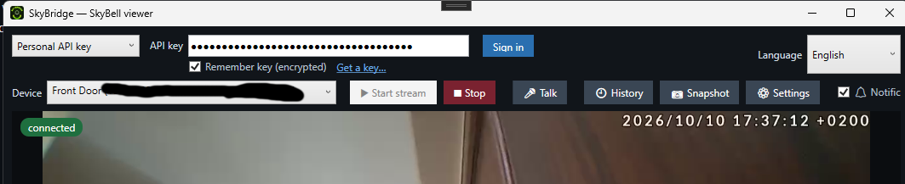
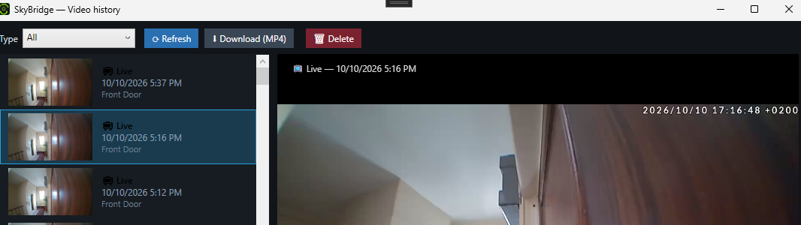
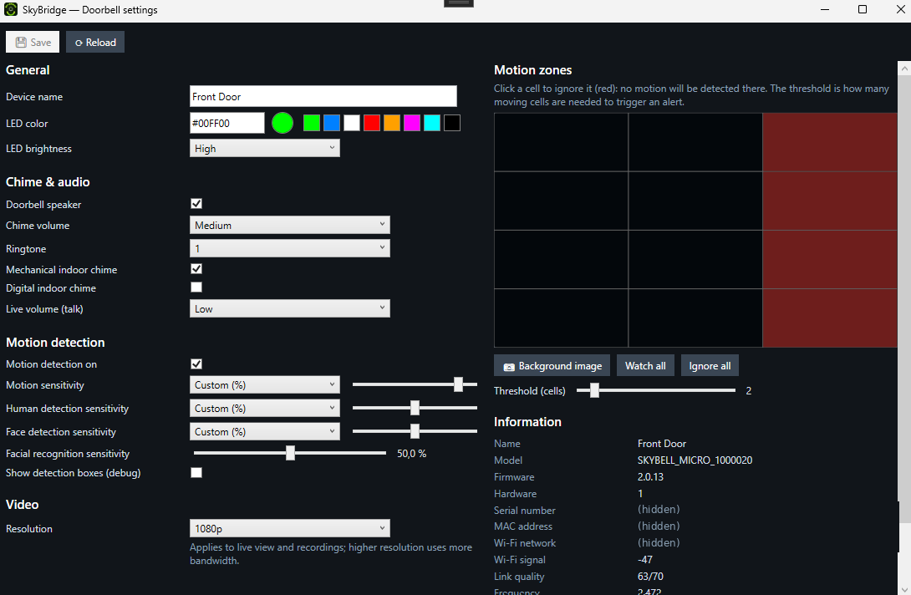

# SkyBell Client for Windows

Freeware Windows client for the **SkyBell Micro** video doorbell: sign in with your SkyBell account to watch the live video, talk to your visitors, browse recorded clips, get notified when someone rings, and change the doorbell settings from your PC.

> Unofficial project. Not affiliated with, endorsed by, or supported by SkyBell Technologies. It talks to your own doorbell with your own credentials, for personal use.

## Download

Get the latest `SkyBridge_Setup_v*.msi` from the [Releases](../../releases/latest) page and run it.

## Requirements

- Windows 10 / 11 (x64; also runs on ARM64 through emulation)
- .NET 10 Desktop Runtime and Microsoft Edge WebView2 Runtime. The installer detects them and offers to download and install them if missing.

## Features

**Live**
- Live video and audio from your SkyBell Micro
- 🎤 **Talk**: speak to your visitor through the PC microphone (two-way audio, the mic is only opened while the button is on)
- 📷 **Snapshot**: ask the doorbell for a fresh picture, save it as JPEG or copy it
- Sign in once, then everything is one click away from the toolbar: **Start / Stop**, **Talk**, **History**, **Snapshot**, **Settings**, **Notifications**

**History**
- 🕘 Browse recorded events (doorbell, motion, live) with thumbnails, filter by type
- Play any clip, download it as MP4, or delete it from the SkyBell cloud (with confirmation)

**Notifications**
- 🔔 Pop-up with a preview when someone rings (and, optionally, on motion), with *Watch live* / *View clip* shortcuts
- Near-instant on the same network as the doorbell (local UDP broadcast, port 5000; the installer adds the firewall rule), otherwise checked every 60 s through the SkyBell API
- Works while the app is running

**Doorbell settings** (⚙)
- Device name, LED colour and brightness
- Doorbell speaker, chime volume and ringtone, indoor mechanical / digital chime, live talk volume
- Motion detection and sensitivities (motion, human, face, facial recognition), video resolution
- **Motion-zone editor**: click cells over a live snapshot to ignore areas, set the trigger threshold
- Device information: model, firmware, Wi-Fi signal and link quality, last connection
- Only the settings you change are sent

**Sign-in**
- SkyBell email / password, or a **personal API key** generated at [api.skybell.network/developers](https://api.skybell.network/developers)
- "Remember" options: the password and the API key are encrypted with Windows DPAPI, bound to your Windows account
- English / French interface

## License

MIT (see `LICENSE`). Only the installer is distributed here; the source code is not published.

## Disclaimer

- **Unofficial.** SkyBell Client for Windows is an independent project. It is not affiliated with, endorsed by, or supported by SkyBell Technologies. "SkyBell" and "SkyBell Micro" are trademarks of their respective owner and are used only to identify the compatible product.
- **Use at your own risk.** The software is provided "as is", without warranty of any kind (see `LICENSE`). The author is not liable for any damage, data loss, account suspension, or other consequence of using it.
- **Your account, your responsibility.** The app signs in to SkyBell's cloud service with the credentials you enter, using the same network calls as the official mobile app. Using it may be restricted by SkyBell's terms of service; check them before use. It must only be used with your own doorbell and account.
- **Privacy.** Your credentials (or API key) are sent only to SkyBell's servers. If you choose to remember them, they are stored encrypted with Windows DPAPI on your PC. Thumbnails are cached locally under `%LOCALAPPDATA%\Skywin`. No data is sent to the author.
- **Your API key is a password.** A personal API key gives full access to your SkyBell account: never share it or post it publicly.
- **Deleting is permanent.** Events deleted from the history are removed from the SkyBell cloud and cannot be recovered.
- **Not for security-critical use.** Do not rely on this app as your only way to see or answer your door.
