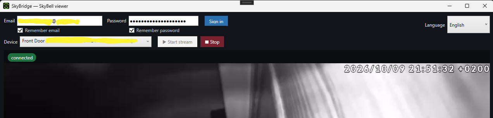

# SkyBell Client for Windows

Freeware Windows client for the **SkyBell Micro** video doorbell: sign in with your SkyBell account and watch the live video and audio on your PC.

> Unofficial project. Not affiliated with, endorsed by, or supported by SkyBell Technologies. It talks to your own doorbell with your own credentials, for personal use.

## Download

Get the latest `SkyBridge_Setup_v*.msi` from the [Releases](../../releases/latest) page and run it.

## Requirements

- Windows 10 / 11 (x64; also runs on ARM64 through emulation)
- .NET 10 Desktop Runtime and Microsoft Edge WebView2 Runtime. The installer detects them and offers to download and install them if missing.

## Features

- Live video and audio from your SkyBell Micro
- "Remember email / password" (the password is encrypted with Windows DPAPI)
- English / French interface

## License

MIT (see `LICENSE`). Only the installer is distributed here; the source code is not published.

## Disclaimer

- **Unofficial.** SkyBell Client for Windows is an independent project. It is not affiliated with, endorsed by, or supported by SkyBell Technologies. "SkyBell" and "SkyBell Micro" are trademarks of their respective owner and are used only to identify the compatible product.
- **Use at your own risk.** The software is provided "as is", without warranty of any kind (see `LICENSE`). The author is not liable for any damage, data loss, account suspension, or other consequence of using it.
- **Your account, your responsibility.** The app signs in to SkyBell's cloud service with the credentials you enter, using the same network calls as the official mobile app. Using it may be restricted by SkyBell's terms of service; check them before use. It must only be used with your own doorbell and account.
- **Privacy.** Your credentials are sent only to SkyBell's servers. If you choose "remember password", it is stored encrypted with Windows DPAPI on your PC. No data is sent to the author.
- **Not for security-critical use.** Do not rely on this app as your only way to see or answer your door.
